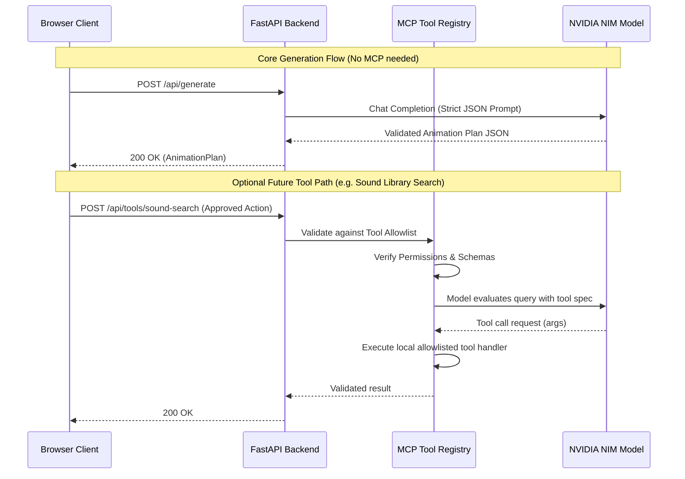
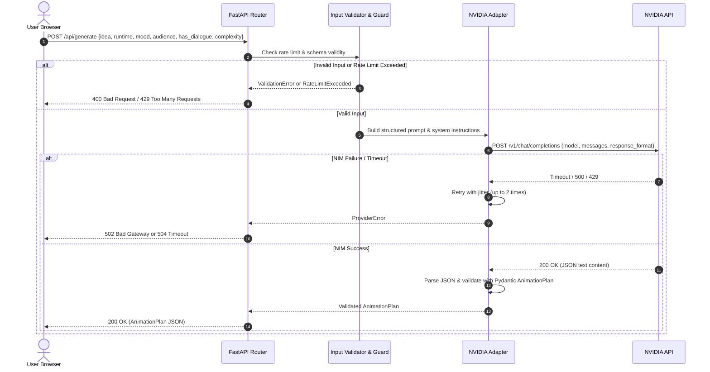
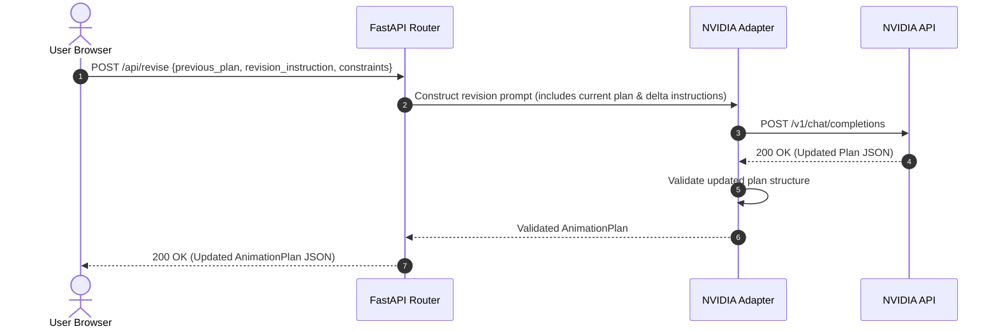

# Frame by Frame: Animation Idea Generator — Architecture Specification

## 1. System Overview

"Frame by Frame: Animation Idea Generator" follows a modular, secure, server-mediated architecture. The browser client interacts exclusively with the local application backend. All interactions with external AI providers (NVIDIA NIM) and optional future tool providers (MCP servers) are performed strictly server-side.

```mermaid
flowchart TD
    subgraph ClientBrowser ["Client Browser (Zero-Build Frontend)"]
        UI["Modern Web UI\n(HTML5, CSS3, Vanilla JS)"]
        State["Client State\n(Active Plan, Edits)"]
        UI <--> State
    end

    subgraph BackendApp ["Application Backend (FastAPI / Python 3.14)"]
        Router["API Router\n(/api/generate, /api/revise, /health)"]
        Limiter["Rate Limiter & Input Validator\n(Pydantic v2 + Token Bucket)"]
        Orchestrator["Prompt Orchestrator & Safety Guard\n(Audience & Style Check)"]
        Adapter["NVIDIA Provider Adapter\n(HTTPX Async Client + Tenacity Retries)"]
        MCPBoundary["MCP Integration Boundary\n(Client Host, Tool Allowlist, Schema Validator)"]

        Router --> Limiter
        Limiter --> Orchestrator
        Orchestrator --> Adapter
        Orchestrator -.-> MCPBoundary
    end

    subgraph ExternalServices ["External Services"]
        NvidiaAPI["NVIDIA NIM / Hosted Model API\n(OpenAI-Compatible Chat Completions)"]
        FutureMCPServers["Future MCP Tool Servers\n(e.g., Sound Library, Storyboard Export)"]
    end

    UI -->|JSON over HTTPS/HTTP| Router
    Adapter -->|Bearer Token Auth (Server Only)| NvidiaAPI
    MCPBoundary -.->|Stdio / SSE RPC (Future)| FutureMCPServers
```

---

## 2. Component Responsibilities

### 2.1 Browser UI
- **Technology**: Single-page vanilla HTML5, semantic CSS3, and modern modular ES6 JavaScript. No Node.js build step or frontend bundlers required.
- **Responsibilities**:
  - Collect user inputs: idea prompt, runtime, mood, audience, dialogue flag, complexity level.
  - Validate constraints on the client (e.g., character counts, empty strings) prior to dispatch.
  - Render generated animation plan into editable form controls (`contenteditable` or modular input/textarea fields).
  - Provide inline editing and preserve user modifications in local JavaScript memory during the session.
  - Present revision controls ("Make the ending funnier", "Simplify scene 2").
  - Formatted one-click clipboard copy.
  - **Security Mandate**: Never execute or inject model output as raw HTML. All model-generated text is rendered via `element.textContent` or form input values (`textarea.value`), guaranteeing immunity to Cross-Site Scripting (XSS).

### 2.2 Application Backend
- **Technology**: Python 3.14 + FastAPI + Uvicorn + Pydantic v2.
- **Responsibilities**:
  - Serve static frontend assets (`index.html`, `styles.css`, `app.js`).
  - Provide RESTful API endpoints: `/api/generate`, `/api/revise`, `/health`.
  - Enforce server-side validation using Pydantic schemas.
  - Enforce sliding-window / token-bucket IP rate limiting.
  - Apply content safety, audience calibration, and living artist style replacement.
  - Execute async requests to the NVIDIA model endpoint.
  - Sanitize logs to ensure API keys, authorization headers, and raw user prompts are never written to permanent disk logs.
  - Mask all internal exceptions so external API consumers only receive clean, safe error envelopes.

### 2.3 NVIDIA Provider Adapter
- **Protocol**: OpenAI-compatible chat completions protocol used by NVIDIA NIM endpoints (`/v1/chat/completions`).
- **Configuration (Environment Variables)**:
  - `NVIDIA_API_KEY`: Secret API key for NVIDIA API Catalog or private NIM instance.
  - `NVIDIA_BASE_URL`: Base URL (default: `https://integrate.api.nvidia.com/v1`).
  - `NVIDIA_MODEL`: Model identifier (e.g., `meta/llama-3.1-70b-instruct` or `mistralai/mixtral-8x22b-instruct`).
  - `NVIDIA_TIMEOUT_SECONDS`: Request timeout in seconds (default: `45.0`).
  - `NVIDIA_MAX_RETRIES`: Maximum bounded retry attempts for 5xx/transient network errors (default: `2`).
- **Resilience**:
  - Built with `httpx.AsyncClient` with connection pooling.
  - Bounded exponential backoff with jitter using `tenacity` on HTTP 429 and 5xx responses.
  - Strict fallback and validation: Parses JSON output, enforces fallback parsing if markdown code blocks (` ```json `) are present, and validates against the Pydantic `AnimationPlan` model.
  - Graceful degradation: When `NVIDIA_API_KEY` is absent or unconfigured, the adapter enters a documented mock/dry-run mode for local development and testability, or returns an explicit `503 Service Unavailable` with guidance.

---

## 3. Extensible MCP (Model Context Protocol) Boundary

### 3.1 Architectural Philosophy
Model Context Protocol (MCP) allows models to securely interface with tools, data sources, and services. In this architecture:
- **No Direct Browser Access**: The browser client *never* speaks directly to an MCP server.
- **Server as MCP Host**: The FastAPI backend acts as the MCP client/host.
- **Decoupled from Core Generation**: The first release does not require any external MCP server to operate. Core generation is self-contained.
- **Extension Boundary**: An abstract `MCPClientInterface` and `ToolRegistry` are established in the backend codebase.



### 3.2 MCP Security Guardrails
1. **Tool Allowlist**: Only explicitly registered and approved tools can be discovered or executed by the model.
2. **Schema Validation**: Tool inputs and outputs are validated strictly via Pydantic schemas.
3. **Execution Gating**: Any future tool that mutates data, accesses external networks, publishes content, or incurs cost requires explicit user confirmation via the UI before execution.
4. **Timeout & Isolation**: Tool invocations run with independent timeouts and cannot access system shell or unauthorized filesystems.

---

## 4. Request & Data Flows

### 4.1 Plan Generation Sequence



### 4.2 Plan Revision Sequence



---

## 5. Security, Privacy, and Content Safeguards

| Domain | Policy & Implementation |
| :--- | :--- |
| **XSS Prevention** | Client strictly assigns text via `.textContent`, `.value`, or DOM text nodes. No `innerHTML` or `dangerouslySetInnerHTML`. |
| **Data Persistence** | **Zero-persistence architecture**. No database, no session caching on disk, and no database models. Ideas and plans exist solely in volatile client memory and transit memory. |
| **Input Sanitization** | Inputs constrained to strict length (Idea: 5–500 chars; Revision: 3–300 chars). HTML/script tags stripped/escaped. Strict enum validation. |
| **Rate Limiting** | In-memory token bucket rate limiting (10 requests/min per client IP) to prevent API abuse and cost overrun. |
| **Secrets Management** | `NVIDIA_API_KEY` stored exclusively in server environment variables / `.env`. Never bundled or sent to the browser. Safe error handling prevents stack traces or environment leaks. |
| **Logging Safety** | Server logs record timestamps, HTTP status, and latency. Secret headers (`Authorization`) and raw user prompts are scrubbed from default application logs. |
| **Artist Protection** | Automated system prompt rules intercept requests for specific living artists (e.g. *"in the style of [Artist]"*) and translate them to generic artistic descriptors. |
| **Content Boundaries** | Strict audience-appropriate prompt framing (`children`, `teens`, `general`) to reject gore, sexual content, hate speech, or non-age-appropriate themes. |
| **Informational Note** | Prominently displays that the app provides AI-generated suggestions requiring human review, and advises against submitting trade secrets or confidential scripts. |
